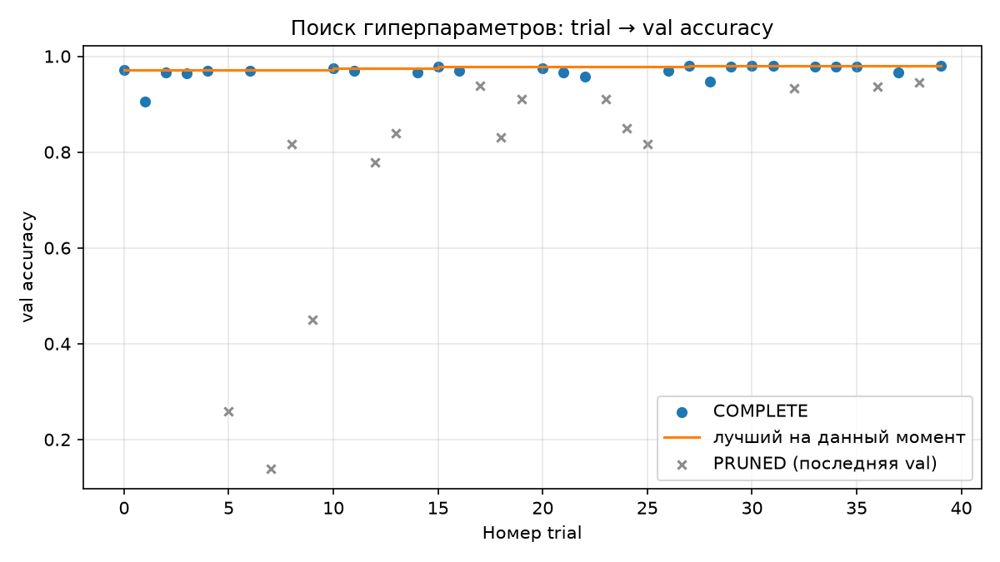
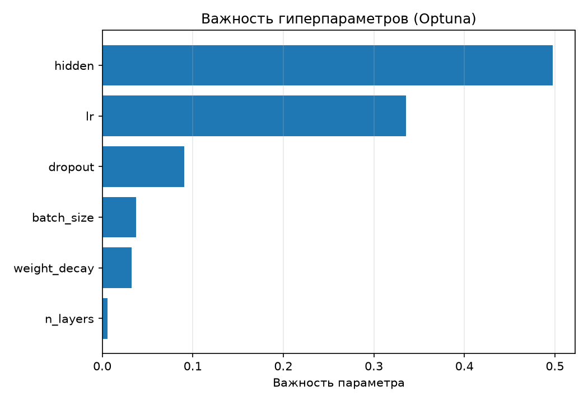

# ЛР0. Воспроизводимый эксперимент: подбор гиперпараметров MLP

_Отчёт сформирован автоматически 2026-10-28 20:11, коммит `3ba2bef`. Числа берутся из `reports/lr0/*.json`; блоки `manual` предназначены для ручного текста и сохраняются при повторной сборке._

## 1. Вопрос и прогноз

**Вопрос.** Дал ли подбор гиперпараметров улучшение, которое больше случайного
разброса?

<!-- manual:forecast -->
Прогноз: `val_acc` будет иметь разброс в пределах 1-2 процентов в зависимости от seed, в редких случаях может быть более сильный разброс; лучший trial превзойдет базовую конфигурацию также на 1-2 процента; на новых seed улучшение скорее всего сохранится, но может стать меньше (например улучшение на 0.5%, а не на 2%), на test улучшение должно сохраниться.
<!-- /manual:forecast -->

## 2. Что сделано

- Каркас запусков: конфигурация, каталог `runs/<run_id>/`, `metadata.json`,
  `history.csv`, `predictions.csv`, `metrics.json`, запись в MLflow.
- Данные: `load_digits`, признаки /16, стратифицированное разбиение
  20 % / 25 % остатка, `split_seed = 0`, хеш `split.json` в манифесте.
- Модель: MLP `64 → n_layers × hidden (ReLU, dropout) → 10`, кросс-энтропия,
  Adam, 30 эпох; seed и число потоков фиксируются.
- Эксперимент 1: повторяемость, серия `base_seeds` (seed 1–5), сравнение
  предсказаний двух seed на val.
- Эксперимент 2: Optuna, `TPESampler(seed=42)`, `MedianPruner(5, 5)`,
  пространство параметров из `configs/lr0/search_space.yaml`.
- Эксперимент 3: `base` и `best`, seed 101–105, оценка на test, попарное
  сравнение по изображениям.

Таблица 1. Запись из metadata.json
| Поле | Значение |
|---|---|
| Источник | scikit-learn 1.9.1 |
| Правило | test 20 %, val 25 % остатка, split_seed=0, stratify=y |
| Размеры | train=1077, val=360, test=360 |
| sha256 split.json | `15784ba5a76de42d…` |

Таблица 2. Сравнение базовой и лучшей конфигураций
| Параметр | base | best |
|---|---|---|
| seed | 0 | 0 |
| n_layers | 1 | 3 |
| hidden | 64 | 458 |
| dropout | 0 | 0.235776 |
| lr | 0.001 | 0.00469518 |
| weight_decay | 0 | 3.27091e-06 |
| batch_size | 64 | 128 |
| epochs | 30 | 30 |

## 3. Результаты

### 3.1. Повторяемость и разброс (эксперимент 1)

Повторяемость: **да**. Два запуска с `seed = 0` дали одинаковые `history.csv` и `predictions.csv`: `lr0-experiment1-2026-10-28_20-07-40-c083bb`, `lr0-experiment1-2026-10-28_20-07-43-7abd0e`.

Таблица 3. Запуск с seed = [1; 5]
| seed | run_id | val_acc | train_time, с |
|---|---|---|---|
| 1 | `lr0-experiment1-2026-10-28_20-07-44-e1c985` | 0.9583 | 0.61 |
| 2 | `lr0-experiment1-2026-10-28_20-07-45-da43e4` | 0.9583 | 0.63 |
| 3 | `lr0-experiment1-2026-10-28_20-07-46-4b1f40` | 0.9528 | 0.62 |
| 4 | `lr0-experiment1-2026-10-28_20-07-47-cfe672` | 0.9528 | 0.61 |
| 5 | `lr0-experiment1-2026-10-28_20-07-48-474c7a` | 0.9611 | 0.65 |

val_acc по seed 1–5: min = **0.9528**, median = **0.9583**, max = **0.9611**; разброс = **0.83 п.п.** (одно изображение val = 0.28 п.п.).

Таблица 4. Сравнение предсказаний двух seed на val (N = 360)

|  | второй верно | второй ошибся |
|---|---|---|
| первый верно | 341 | 1 |
| первый ошибся | 4 | 14 |

Первый — `seed 0`, второй — `seed 1`. Точность первого = **0.9500**, второго = **0.9583**, Δ = **+0.83 п.п.** Второй исправил **4** и испортил **1**.

Запуски: `lr0-experiment1-2026-10-28_20-07-40-c083bb`, `lr0-experiment1-2026-10-28_20-07-44-e1c985`.

Таблица 5. Примеры расхождений

| index | y_true | pred первого | pred второго | кто прав |
|---|---|---|---|---|
| 177 | 1 | 9 | 1 | второй |
| 489 | 3 | 5 | 3 | второй |
| 1229 | 0 | 5 | 0 | второй |
| 1283 | 0 | 5 | 0 | второй |
| 1790 | 8 | 8 | 1 | первый |

### 3.2. Поиск гиперпараметров (эксперимент 2)

Таблица 6. Состояние из Optuna
| Состояние | Trial |
|---|---|
| COMPLETE | 25 |
| PRUNED | 15 |

Выполнено **829** эпох из **1200** (40 × 30) — **69.1 %**. Прунер остановил **15** trial и сэкономил **371** эпох (**30.9 %** плана).

Среднее время эпохи ≈ **0.075 с**. Оценка экономии прунера: **27.7 с** (371 эпох × среднее время эпохи). Фактическое время поиска ≈ **59.9 с**; оценка полного прогона без прунера ≈ **89.7 с**.

Таблица 7. Лучший trial
| Параметр | Значение |
|---|---|
| trial | #27 |
| val_acc | 0.9806 |
| lr | 0.00469518 |
| n_layers | 3 |
| hidden | 458 |
| dropout | 0.235776 |
| weight_decay | 3.27091e-06 |
| batch_size | 128 |

Таблица 8. Важность параметров
| Параметр | Важность | Доля |
|---|---|---|
| hidden | 0.4978 | 49.8 % |
| lr | 0.3355 | 33.5 % |
| dropout | 0.0908 | 9.1 % |
| batch_size | 0.0375 | 3.8 % |
| weight_decay | 0.0326 | 3.3 % |
| n_layers | 0.0059 | 0.6 % |

Рисунок 1. Поиск гиперпараметров

Рисунок 2. Важность гиперпараметров

### 3.3. Честное сравнение (эксперимент 3)

Серия `final`; run_id по каждому seed — в `experiment_3.json`.

Таблица 9. Точности базовой и лучшей конфигураций на разных seed
| seed | base val | best val | Δ val, п.п. | base test | best test | Δ test, п.п. | corrected | spoiled |
|---|---|---|---|---|---|---|---|---|
| 101 | 0.9556 | 0.9611 | +0.56 | 0.9528 | 0.9417 | -1.11 | 6 | 10 |
| 102 | 0.9611 | 0.9750 | +1.39 | 0.9444 | 0.9583 | +1.39 | 14 | 9 |
| 103 | 0.9500 | 0.9500 | +0.00 | 0.9389 | 0.9583 | +1.94 | 13 | 6 |
| 104 | 0.9528 | 0.9722 | +1.94 | 0.9472 | 0.9639 | +1.67 | 10 | 4 |
| 105 | 0.9528 | 0.9750 | +2.22 | 0.9556 | 0.9667 | +1.11 | 9 | 5 |

Δ val: медиана **+1.39 п.п.**, диапазон **+0.00 … +2.22 п.п.**. Δ test: медиана **+1.39**, диапазон **-1.11 … +1.94**.

Исправлено **52**, испорчено **34** из **1800** (5 × 360), net = **+18**; одно изображение test = 0.28 п.п.

Таблица 10. Потери улучшений точности
| Число | Значение |
|---|---|
| Лучший trial на val | 0.9806 |
| Средняя val лучшей конфигурации (seed 101–105) | 0.9667 |
| Средняя test лучшей конфигурации | 0.9578 |

Падение «лучший trial → новые seed» = **-1.39 п.п.**; «новые seed val → test» = **-0.89 п.п.**.

Минимальный Δ test = **-1.11 п.п.**; разброс base по seed = **0.83 п.п.**

## 4. Разбор примеров и ошибок

<!-- manual:error_analysis -->

**Ошибки на val (эксперимент 1).** Точности seed 0 и seed 1 различаются
на 0.83 п.п., но это всего 3 изображения из 360. Расхождения затрагивают
5 изображений: seed 0 путает 0 и 3 с 5 (индексы 489, 1229, 1283) и 1 с 9
(177); seed 1 исправляет эти 4 ошибки, но ломает одно изображение 8→1
(1790). Ещё 14 ошибок у запусков общие. Поэтому разница 0.83 п.п. — шум,
а не преимущество одного seed; при этом составы ошибок действительно
различаются.

**Ошибки на test (эксперимент 3).** Ошибки сильно кластеризованы: все
94 ошибки base приходятся всего на 23 изображения из 360, причём
14 изображений неверны у всех пяти seed. Лучшая конфигурация исправляет
10 из этих 14, но добавляет новые ошибки: у неё остаются 4 изображения,
неверных при всех пяти seed (794, 1264, 1628, 1660). То есть seed-разброс
занижает реальную сложность: одни и те же изображения стабильно
проблемные.

**Основные путаницы.** У base: 8→1 — 22 раза, 2→1 — 11, 4→8 — 9, далее
по 5: 3→7, 0→4, 9→1, 5→3, 6→1, 8→5, 1→9. У best: 8→1 — 13, 4→1 — 7,
2→1 — 6, по 5: 2→3, 8→5, 4→9. Класс 8 — самый сложный (84.6 % у base,
87.4 % у best), класс 7 распознаётся идеально.

**По классам** (точность, corrected — base ошибся/best верно, spoiled —
наоборот):

| Класс | base | best | corrected | spoiled |
|---|---:|---:|---:|---:|
| 0 | 97.2 % | 98.3 % | 2 | 0 |
| 1 | 94.4 % | 93.3 % | 5 | 7 |
| 2 | 93.7 % | 93.7 % | 6 | 6 |
| 3 | 96.2 % | 100 % | 7 | 0 |
| 4 | 94.4 % | 93.3 % | 0 | 2 |
| 5 | 97.3 % | 97.3 % | 4 | 4 |
| 6 | 96.1 % | 97.8 % | 3 | 0 |
| 7 | 100 % | 100 % | 0 | 0 |
| 8 | 84.6 % | 87.4 % | 15 | 10 |
| 9 | 93.3 % | 96.1 % | 10 | 5 |

Итого best исправил **52** изображения и испортил **34** из 1800.
Улучшение дают классы 3, 9, 8, 0 и 6; классы 1 и 4 немного ухудшаются;
класс 2 остаётся без изменений.

**Отрицательный seed 101.** На нём val выросла на 0.56 п.п., а test упал
на 1.11 п.п.: best исправил 6 изображений, но испортил 10. Четыре из
десяти испорченных — это класс 2, который best предсказал как 3 (индексы
538, 700, 1364, 1742). Это хороший пример того, что выбор по val не
гарантирует переноса на test.

По таблице 5 видно, что примеры 177 и 489—1283 показывают разные
стратегии ошибок: seed 0 «стягивает» 0/3/1 к 5 и 9, seed 1 исправляет
их, но ошибается на 8→1. Это не деградация модели, а смена состава
ошибок при смене seed.
<!-- /manual:error_analysis -->

## 5. Выводы и границы

<!-- manual:conclusions -->

**Ответ на главный вопрос: нет, по текущим данным подбор не дал
улучшения, которое уверенно больше случайного разброса.**

Разброс базовой конфигурации по seed в эксперименте 1 — **0.83 п.п.**
В эксперименте 3 Δ test по seed: **−1.11, +1.39, +1.94, +1.67, +1.11
п.п.**; медиана **+1.39**, среднее **+1.0**, диапазон **−1.11 … +1.94**.
Четыре seed положительны, один отрицателен, диапазон пересекает ноль.
Суммарно best исправил **52** и испортил **34** изображения из 1800,
net **+18** (+1.0 п.п.).

Критерий «все пять Δ положительны и больше разброса» не выполнен: одна
разность отрицательна, а минимальная Δ (−1.11) меньше разброса base
(0.83). Утверждать, что best лучше base, нельзя; можно говорить лишь о
слабой средней тенденции около +1 п.п., которая сопоставима с шумом.

Лучший trial имел **0.9806** на val. На новых seed та же конфигурация
даёт **0.9667**, на test — **0.9578**: падение на **1.39** и **0.89 п.п.**
соответственно. Часть преимущества лучшего trial — смещение отбора:
конфигурация выбиралась по val seed 0, поэтому её val-оценка
оптимистична. Новые seed и test показывают, что эффект меньше и
нестабилен.

**Границы.** Выводы относятся к digits 8×8, одному разбиению
(`split_seed = 0`), пяти seed 101–105, MLP с 30 эпохами, 40 trial и CPU.
Одно test-изображение — это 0.28 п.п., поэтому даже «плюс 4 изображения»
меняет вывод. На других данных, другой архитектуре или другом сплите
результат может отличаться; test не использовался для выбора
конфигурации, только для финальной оценки.
<!-- /manual:conclusions -->

## 6. Ограничения и что улучшить

<!-- manual:limitations -->

| Ограничение | Что улучшить |
|---|---|
| Всего 5 seed и 360 test-изображений; 1 изображение = 0.28 п.п. | Увеличить до 10–20 seed, считать парные Δ, медиану, диапазон и знаковый тест/бутстрап-CI. |
| Одно разбиение (`split_seed = 0`) | Повторить сравнение на 3–5 split seed или сделать кросс-валидацию; test не трогать до финала. |
| Каждый trial обучается с одним seed 0 | Усреднять objective по 2–3 seed или проверять лучшие конфигурации на нескольких seed — иначе trial-шум влияет на выбор. |
| 40 trial и один seed семплера | Увеличить бюджет, повторить поиск с другими seed TPE, сравнить с `RandomSampler`; проверить, устойчива ли лучшая конфигурация. |
| Прунер остановил 15 из 40 trial (829 из 1200 эпох) | Увеличить `n_warmup_steps`/минимальное число эпох, смотреть кривые val: ранняя val шумная, можно потерять медленно стартующие конфигурации. |
| Только MLP на 8×8, класс 8 заметно хуже остальных | Добавить per-class метрики и confusion matrix в отчёт, попробовать class weights, аугментации или небольшую CNN. |
| `--split-seed` не влияет на разбиение; тесты не восстановлены | Сделать split_seed реальным параметром (пересборка/проверка `split.json`) и вернуть тесты проверок из истории. |
| Повторная финальная оценка после изменений | Зафиксировать test один раз: после получения результата не менять систему и не перезапускать test без явной оговорки в отчёте. |

Короткий вывод для раздела 6: **главное ограничение — статистическая
мощность, а не качество модели.** Сначала стоит увеличить число seed и
сплитов; уже это может показать, является ли +1 п.п. реальным эффектом
или шумом. Затем имеет смысл наращивать бюджет поиска и проверять
устойчивость лучшей конфигурации повторными поисками.
<!-- /manual:limitations -->

## 7. Кодогенерация

<!-- manual:codegen -->
В связи с большим объемом работы использовалась кодогенерации скриптов, а также некоторых фрагментов работы, кодогенерация проверена чтением и корректным выполнением кода.
<!-- /manual:codegen -->

## Приложение. Артефакты

- `reports/lr0/experiment_1.json`, `experiment_2.json`,
  `experiment_3.json` — числовые результаты.
- `reports/lr0/experiment_2_trials.png`,
  `experiment_2_importance.png` — графики поиска.
- `runs/` — каталоги запусков, `mlflow.db` — журнал MLflow,
  `optuna.db` — study `lr0_search`.
