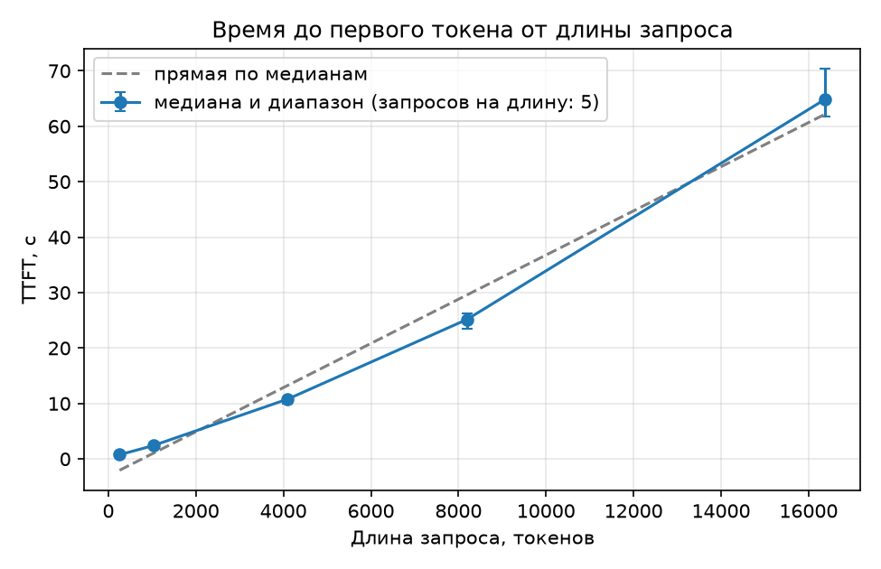
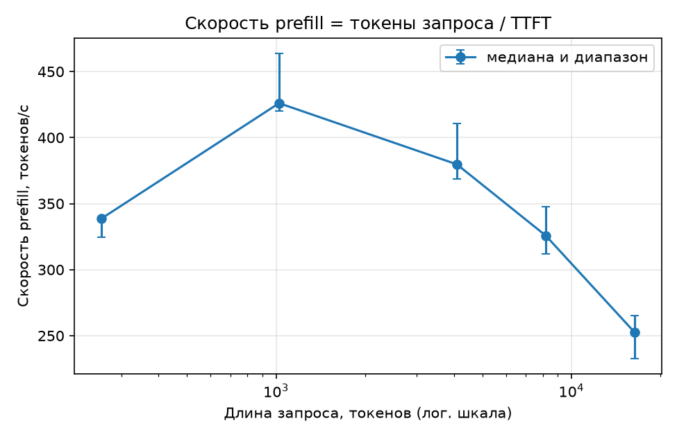
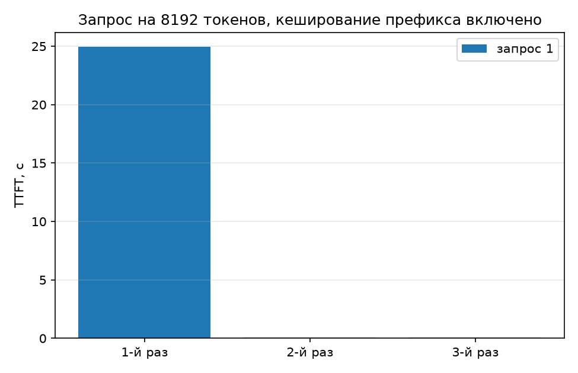
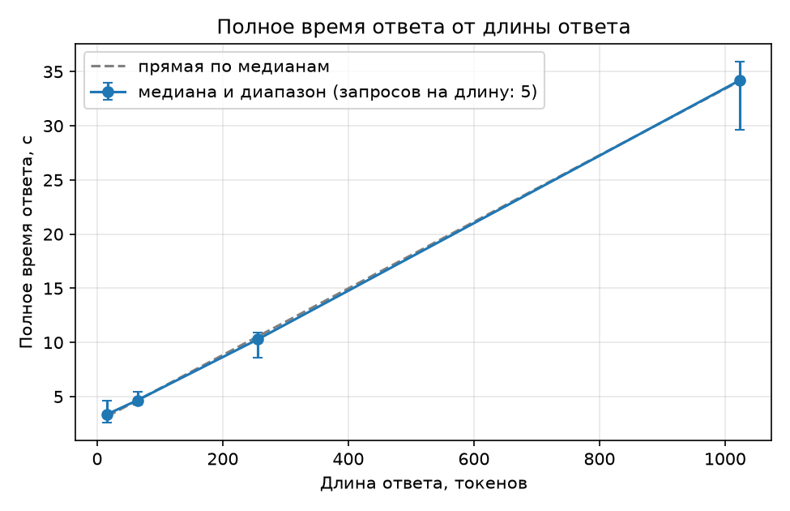
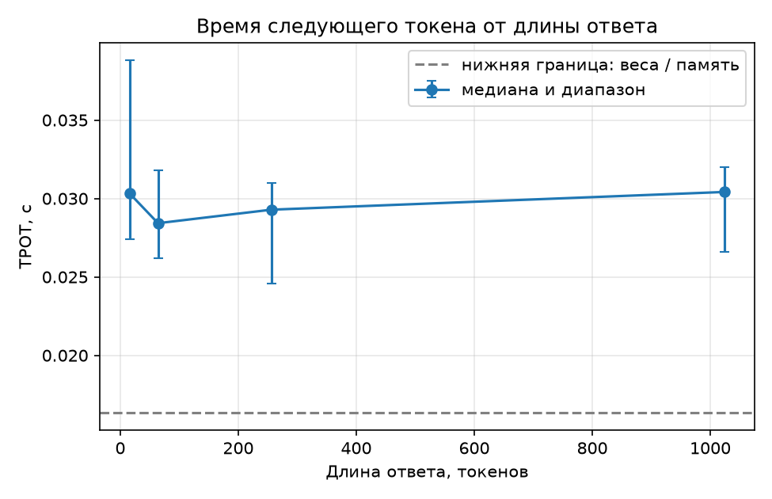
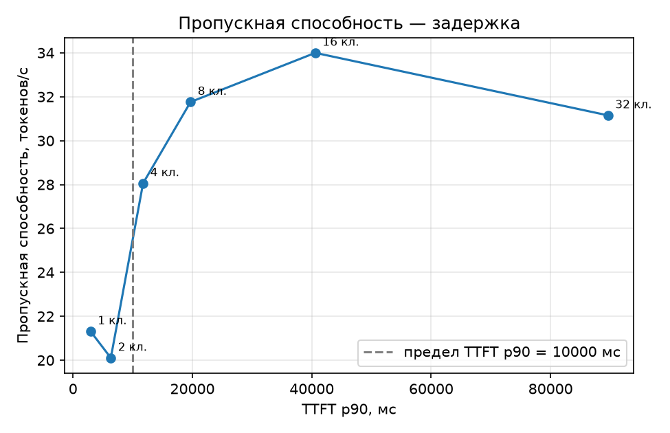
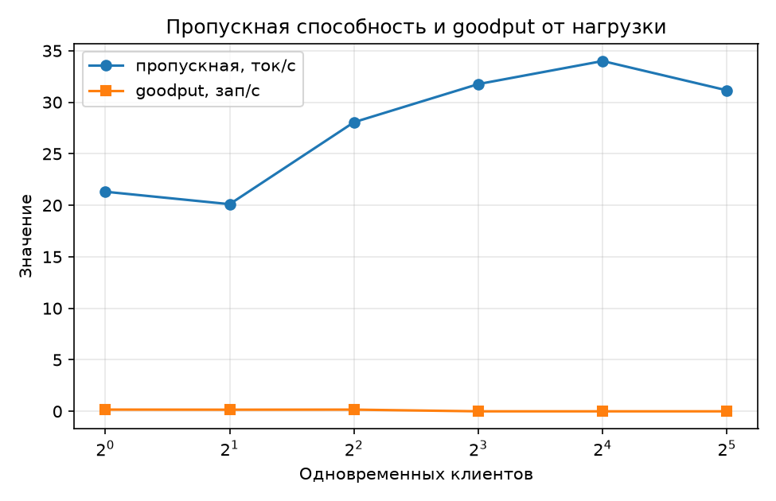

# ЛР1. Инференс и развёртывание языковой модели: от запроса к серверу под нагрузкой

_Отчёт сформирован автоматически 2026-11-13 14:15, коммит `6f5ca93`. Числа берутся из `reports/lr1/*.json`; блоки `manual` предназначены для ручного текста и сохраняются при повторной сборке._

## 1. Вопрос и прогноз

**Вопрос.** Из чего складывается время ответа языковой модели и как оно
меняется, когда пользователей становится много? Лабораторная выполнена
в CPU-профиле: llama.cpp на Apple M1 (8 ГБ ОЗУ), модель Qwen2.5-1.5B-Instruct
в квантовании Q4_K_M, контекст 32 768 токенов.

<!-- manual:forecast -->
Прогноз зафиксирован в `reports/lr1/forecast.md` до запусков. Кратко:
TTFT растёт с длиной запроса почти линейно (prefill упирается в вычисления),
на длинных запросах возможен сверхлинейный рост из-за квадратичного внимания;
TPOT ожидается около нижней границы «веса / память» (≈16 мс для Qwen2.5-1.5B
Q4_K_M на Apple M1), реально — в 2–5 раз выше; суммарная пропускная способность
растёт с числом клиентов, а TTFT p90 и TPOT ухудшаются; пределы интерактивного
ассистента на CPU (TTFT p90 ≤ 10 с, медиана TPOT ≤ 150 мс) перестанут
выполняться при заполнении KV-кеша и появлении очереди.
<!-- /manual:forecast -->

## 2. Что сделано

- Собственный OpenAI-совместимый сервер llama.cpp (CPU) с моделью
  Qwen2.5-1.5B-Instruct, GGUF Q4_K_M, контекст 32 768 токенов; команда
  запуска и журнал — в паспорте.
- Клиент-измеритель каркаса ЛР0: потоковый запрос `stream=True` с
  `stream_options={"include_usage": true}`, отметки `time.perf_counter()`,
  TTFT, TPOT, полное время, токены из `usage`, запись в `results.jsonl`.
- Запросы заданной длины из «Pride and Prejudice»: уникальная метка в начале,
  инструкция и начало текста, отрезанное токенизатором модели; длина сверяется
  с `usage.prompt_tokens`.
- Паспорт сервера и проверки п. 3.4: ёмкость KV-кеша, ровно 64 токена с
  `ignore_eos`, температура 0 и два одинаковых запроса.
- Эксперимент 1: TTFT от длины запроса (256–16 384 токенов, 5 запросов на
  длину) и повтор одного запроса с включённым кешированием префикса.
- Эксперимент 2: полное время от длины ответа (16, 64, 256, 1024 токена,
  5 запросов на длину) с `ignore_eos`.
- Эксперимент 3: нагрузка 1, 2, 4, 8, 16, 32 клиента, `max(8, 2c)` запросов
  на уровень, общая очередь, метрики очереди до и после уровня.
- Паспорт снят при сервере с `--no-cache-prompt`; во второй серии опыта 1
  и в опытах 2–3 сервер запускался без этого флага (кеш включён), в опыте 3 —
  с `-c 65536 -np 32`.

| Поле | Значение |
|---|---|
| Модель | Qwen/Qwen2.5-1.5B-Instruct @ 989aa7980e4c… |
| Сервер | llama.cpp 0.9.0 (build 12110, commit cd959bae9) |
| Команда запуска | `llama-server -hf Qwen/Qwen2.5-1.5B-Instruct-GGUF:Q4_K_M --alias Qwen/Qwen2.5-1.5B-Instruct -c 32768 -np 1 -t 6 -tb 6 --host 127.0.0.1 --port 8000 --metrics --no-webui -lv 5 --log-file /tmp/lr1-llama/llama.log --no-cache-prompt` |
| Предел контекста | 32768 |
| Формат весов | Q4_K - Medium |
| KV-кеш | 28672 байт/токен; 32768 токенов; 0.88 GiB; тип f16 |
| Устройство | Apple M1, 8.0 ГиБ ОЗУ; потоков: 8 |
| Проверки | KV-кеш: да; ровно токенов: да; длина запроса: да; все запросы: да |

| Поле | Значение |
|---|---|
| Источник | Project Gutenberg, ebook #1342: Jane Austen, Pride and Prejudice |
| URL | https://www.gutenberg.org/cache/epub/1342/pg1342.txt |
| Правило отбора | текст между маркерами '*** START OF' и '*** END OF' Project Gutenberg, переводы строк приведены к LF |
| Итог отбора | символов: было 763082, осталось 728714; исключено: заголовок и лицензия Project Gutenberg |
| Записей в файле | 1 |
| sha256 | `ec5006ab5edb21cf…` |

| Величина | Значение |
|---|---|
| Память весов | 1.04 GiB (Qwen2.5-1.5B-Instruct, Q4_K_M, ≈1.11 ГБ) |
| Нижняя граница шага decode | 16 мс при 68 ГБ/с (61 ток/с) |
| KV-кеш на токен | 28672 байт |
| KV-кеш на 8 пользователей по 4000 токенов | 0.85 GiB |
| KV-кеш на весь контекст | 0.88 GiB |

## 3. Результаты

### 3.1. Длина запроса и TTFT (эксперимент 1)

**Таблица 1.** TTFT и скорость prefill по длине запроса. Серия `ttft_vs_length`, run_id `lr1-experiment1-2026-11-13_13-47-33-d47053`; запросов на длину: 5, ответ 16 токенов.

| Длина (цель) | Запрос по usage | Успешно | TTFT медиана, мс | TTFT мин–макс, мс | Prefill, ток/с |
|---|---|---|---|---|---|
| 256 | 256 | 5/5 | 756 | 754–788 | 339 |
| 1024 | 1024 | 5/5 | 2404 | 2207–2438 | 426 |
| 4096 | 4096 | 5/5 | 10787 | 9968–11112 | 380 |
| 8192 | 8192 | 5/5 | 25149 | 23559–26245 | 326 |
| 16384 | 16384 | 5/5 | 64901 | 61790–70360 | 252 |

Прямая по медианам: TTFT = -3065 мс + 3.9837 мс × токены; скорость prefill ≈ 251 ток/с.

Рост TTFT между соседними длинами: 256-1024: ×3.18 при росте длины ×4.00; 1024-4096: ×4.49 при росте длины ×4.00; 4096-8192: ×2.33 при росте длины ×2.00; 8192-16384: ×2.58 при росте длины ×2.00.

Максимум токенов из кеша префикса за запрос: 0.

_TTFT от длины запроса._

_Скорость prefill по длине._

### 3.2. Кеширование префикса (эксперимент 1, вторая серия)

**Таблица 2.** Один и тот же запрос повторён трижды при включённом кешировании префикса. Серия `prefix_cache`, run_id `lr1-experiment1-2026-11-13_13-58-18-b3058c`; запрос 8192 токенов.

| Запрос | Успешно | TTFT 1-й, мс | TTFT 2-й, мс | TTFT 3-й, мс | Ускорение 1/2 | Ускорение 1/3 |
|---|---|---|---|---|---|---|
| 1 | 3/3 | 24950 | 75 | 58 | 331.06 | 432.28 |

Медиана ускорения: второй запрос ×331.06, третий ×432.28. Первый запрос проверен по счётчику попаданий: он должен быть холодным.

_TTFT повторных запросов._

### 3.3. Длина ответа и скорость генерации (эксперимент 2)

**Таблица 3.** Полное время ответа и скорость генерации по длине ответа. Серия `decode_memory`, run_id `lr1-experiment2-2026-11-13_13-59-29-10ef3c`; запросов на длину: 5, запрос 1024 токенов, ignore_eos.

| Длина ответа | Ответ по usage | Успешно | e2e медиана, мс | TTFT медиана, мс | TPOT медиана, мс | Decode, ток/с |
|---|---|---|---|---|---|---|
| 16 | 16 | 5/5 | 3374 | 2920 | 30 | 33 |
| 64 | 64 | 5/5 | 4660 | 2870 | 28 | 35 |
| 256 | 256 | 5/5 | 10290 | 2703 | 29 | 34 |
| 1024 | 1024 | 5/5 | 34219 | 3018 | 30 | 33 |

Прямая e2e = 2687 мс + 31 мс × N; свободный член отличается от медианы TTFT на -207 мс, наклон — от медианы TPOT на 1 мс.

Нижняя граница TPOT по памяти весов: 16 мс; медиана TPOT 30 мс, превышение ×1.82.

_Полное время от длины ответа._

_TPOT от длины ответа._

### 3.4. Нагрузка (эксперимент 3)

**Таблица 4.** Уровни нагрузки. Серия `load`, run_id `lr1-experiment3-2026-11-13_14-04-08-6f88bc`; запросов на уровень max(8, 2c); пределы TTFT p90 и медианы TPOT — в конфигурации.

| Клиентов | Успешно | Пропускная, ток/с | Запросов/с | TTFT медиана, мс | TTFT p90, мс | TPOT медиана, мс | Goodput, зап/с | Пределы | Очередь после | KV после |
|---|---|---|---|---|---|---|---|---|---|---|
| 1 | 8/8 | 21 | 0.17 | 2855 | 2939 | 28 | 0.17 | да | 0.0 | — |
| 2 | 8/8 | 20 | 0.16 | 6064 | 6338 | 52 | 0.16 | да | 0.0 | — |
| 4 | 8/8 | 28 | 0.22 | 7380 | 11742 | 84 | 0.16 | НЕТ | 0.0 | — |
| 8 | 16/16 | 32 | 0.25 | 11427 | 19691 | 176 | 0.00 | НЕТ | 0.0 | — |
| 16 | 32/32 | 34 | 0.27 | 11495 | 40589 | 355 | 0.00 | НЕТ | 0.0 | — |
| 32 | 64/64 | 31 | 0.24 | 15723 | 89624 | 932 | 0.00 | НЕТ | 0.0 | — |

Наибольшая нагрузка в пределах: 2 клиентов. Ёмкость KV-кеша: 65536 токенов; запросов по 1024 + 128 токенов помещается ≈ 56. Ошибок вызова: 0 из 136.

_Пропускная способность — задержка._

_Пропускная способность по клиентам._

## 4. Разбор примеров

<!-- manual:analysis -->
В опыте 1 TTFT растёт почти линейно до 4096 токенов: 0.76 с на 256,
2.40 с на 1024 и 10.8 с на 4096 токенов, скорость prefill 339–426 ток/с.
Дальше рост ускоряется: 8192 токена — 25.1 с (326 ток/с), 16384 — 64.9 с
(252 ток/с), то есть при удвоении длины TTFT вырос в 2.58 раза. Это
согласуется с квадратичным вниманием и растущей долей чтения KV-кеша;
прямая по медианам даёт 3.98 мс/токен (≈251 ток/с) и отрицательный
свободный член, поэтому на коротких запросах она лишь приближённая.

Кеш префикса сработал отчётливо: первый запрос на 8192 токена занял
24.95 с, второй и третий — 75 и 58 мс (ускорение ×331 и ×432). Счётчик
`prompt_tokens_cached_total` показал 27, 8191 и 8191 токена; первый запрос
был холодным (27 < 10% от 8192 — это служебный префикс шаблона), поэтому
эффект относится именно к кешу, а не к прогреву.

В опыте 2 TTFT стабилен (2.7–3.0 с для запроса 1024 токена), а TPOT почти
не зависит от длины ответа: 28–30 мс, или 33–35 ток/с. Нижняя граница по
памяти весов — 16 мс, реальный TPOT выше в 1.82 раза: кроме чтения весов
на каждом шаге есть внимание по KV-кешу и накладные расходы CPU.

В опыте 3 пропускная способность растёт с 21 до 34 ток/с к 16 клиентам и
слегка падает до 31 ток/с на 32 клиентах, а задержки ухудшаются: TTFT p90
растёт с 2.9 до 89.6 с, медиана TPOT — с 28 до 932 мс. Ошибок вызова нет
ни на одном уровне; пределы TTFT p90 ≤ 10 с и TPOT ≤ 150 мс выполняются
только при 1–2 клиентах, при 4 клиентах TTFT p90 = 11.7 с лишь немного
выходит за предел, а с 8 клиентов goodput равен нулю. Скачки TTFT кратны
волнам запросов (около 6–7 с при 2 клиентах и 11–13 с при 16–32), что
ожидаемо при 32 слотах; снимки `requests_deferred` до и после уровня
показывают 0 после уровня, поэтому по ним нельзя восстановить очередь
внутри волны — для этого нужна отдельная выборка во времени.
<!-- /manual:analysis -->

## 5. Выводы и границы

<!-- manual:conclusions -->
Время ответа на CPU складывается из prefill (TTFT) и последовательного
decode. Prefill растёт примерно линейно до 4096 токенов, затем быстрее:
на 16 384 токенах TTFT достигает 64.9 с, поэтому длинный контекст на этом
железе непригоден для интерактивного режима. Decode почти постоянен:
TPOT ≈ 30 мс (33 ток/с), что в 1.82 раза выше нижней границы 16 мс по
памяти весов; разница — внимание и накладные расходы CPU.

Пропускная способность насыщается около 34 ток/с (0.25 запроса/с) при
16 клиентах; дальше растут только задержки. Пределы интерактивного
ассистента (TTFT p90 ≤ 10 с, медиана TPOT ≤ 150 мс) выдерживают только
1–2 одновременных пользователя; при 4 TTFT p90 уже 11.7 с. Кеш префикса
даёт ускорение повторного запроса на 8192 токена в 331–432 раза, поэтому
для чата с большим системным промптом его нужно держать включённым.

Прогноз частично подтвердился: сверхлинейный рост TTFT на длинных
запросах и деградация под нагрузкой наблюдалась; TPOT оказался лучше
прогноза (28–30 мс против 35–80 мс), ускорение кеша — намного больше
прогнозируемых 2–10 раз, а предел нагрузки — 2 клиента вместо 4–8.

Границы: Qwen2.5-1.5B-Instruct Q4_K_M, llama.cpp на Apple M1 с 8 ГБ ОЗУ,
CPU без GPU; контекст 32 768 (в опыте 3 — 65 536 на 32 слота по 2048);
температура 0; запросы 256–16 384 токенов, ответы 16–1024 токена,
в опыте 3 — 1024 + 128. Числа нельзя переносить на GPU, другую модель
или другое квантование без повторного запуска.
<!-- /manual:conclusions -->

## 6. Кодогенерация

<!-- manual:codegen -->
Код лаборатории, отчётные скрипты и этот текст подготовлены ассистентом
и проверены: 55 тестов (`pytest`), чистый `ruff check`, паспортные проверки
на живом сервере (KV-кеш, ровно 64 токена, длина запроса, детерминизм),
сверка KV-кеша с формулой (28672 байт/токен, 0.875 GiB) и пересчёт всех
чисел отчёта из `results.jsonl` скриптами `report_exp*.py`. Подмена
источника данных вручную не выполнялась.
<!-- /manual:codegen -->

## Приложение. Артефакты

- `reports/lr1/experiment_1.json`, `experiment_2.json`, `experiment_3.json` —
  числовые результаты.
- `reports/lr1/passport.json` — паспорт сервера и проверки.
- `reports/lr1/figures/` — графики, построенные скриптами отчётов.
- `runs/` — каталоги запусков, `mlflow.db` — журнал MLflow.
